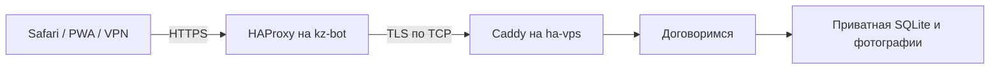

# Вход в приложение через Казахстан

Для доступа с VPN используется существующий HAProxy на `kz-bot`. Приложение, SQLite, фотографии, сессии и VAPID-ключи остаются на `ha-vps`.



HAProxy выбирает российский сервер по TLS SNI `dogovorimsya.online`. TLS завершается на прежнем Caddy: сертификат и его закрытый ключ остаются там. Весь HTTP-трафик приложения, включая загрузки и выдачу личных фотографий, идёт внутри этого соединения. Домен и HTTPS-origin сохраняются, поэтому профили, cookies, PWA и разрешения Web Push продолжают использовать прежний адрес.

Порт 80 выбирает тот же origin по HTTP Host, сохраняя перенаправление на HTTPS и HTTP-проверки продления сертификата. Существующие default backends HAProxy сохраняются. Российский адрес backend задаётся явно, чтобы изменение публичного DNS на KZ не создало петлю проксирования.

## Конфигурация

[Пример HAProxy](../deploy/haproxy.edge.example) использует условные адреса. `192.0.2.10` — origin приложения, `192.0.2.20` — ранее существовавший backend. Перед применением нужно перенести правила в реальный конфиг, сохранив прежние маршруты. HTTP frontend и соответствующие HTTP backends используют `mode http`; HTTPS проходит в `mode tcp`.

На origin в отдельном блоке сайта Caddy:

```caddyfile
dogovorimsya.online {
    encode zstd gzip
    header Alt-Svc clear
    reverse_proxy dogovorimsya-app:3000
}
```

Входной HAProxy передаёт TCP. `Alt-Svc: clear` очищает прежнее объявление HTTP/3, чтобы браузеры не пытались повторно использовать UDP-маршрут через этот вход. Настройка применяется только к сайту приложения.

В публичном DNS основная A-запись указывает на KZ. AAAA добавлять только при готовом маршруте IPv6. Обновление DNS отдельно проверять на авторитативных серверах и на клиенте: сохранённая запись в панели и адрес в кэше VPN могут некоторое время различаться. Переподключение VPN помогает обновить локальный кэш.

## Проверка и откат

Перед изменениями сохранять исходные конфиги и проверять кандидатов через `haproxy -c` / `caddy validate`. Мягкую перезагрузку HAProxy выполняет владелец или агент с отдельным разрешением на root. Пользователь `codex` на KZ не имеет беспарольного sudo; пароль не передаётся в чат.

Проверки выполняются из терминала Mac напрямую и через локальный Happ (`http://127.0.0.1:10809`). По уточнению владельца Happ не применяется ко всему компьютеру. Перед каждым заходом на сайт сначала получить внешний IP из Cloudflare **с теми же параметрами прокси**. Название VPN-локации, интерфейс TUN и `remote_ip` локального HTTP-прокси не подтверждают внешний адрес этого запроса.

Проверять несколько отдельных HTTPS-запросов, сертификат, полную загрузку клиентского скрипта, `/api/status` и отказ 401 на приватных API. Код 200 сам по себе не подтверждает завершение загрузки: проверять код выхода curl и число полученных байтов. ICMP ping не измеряет работу HTTP-прокси. До смены DNS целевой KZ можно проверить через `curl --connect-to`, учитывая возможное переопределение назначения VPN-клиентом при анализе TLS.

Пример проверки через Happ:

```sh
curl --proxy http://127.0.0.1:10809 --noproxy '' \
  https://www.cloudflare.com/cdn-cgi/trace
curl --proxy http://127.0.0.1:10809 --noproxy '' \
  --connect-timeout 8 --max-time 15 \
  -o /dev/null -w '%{http_code} %{time_total}\n' \
  https://dogovorimsya.online/api/status
```

Для прямой проверки использовать `--proxy '' --noproxy '*'` в обоих запросах: сначала Cloudflare, затем сайт. Владелец указал Cloudflare как достоверную проверку выхода Happ. Не выключать проверку сертификатов для получения успешного результата.

Откат: вернуть прежний конфиг HAProxy и выполнить reload; при необходимости вернуть прежнюю A-запись. Отдельное изменение `Alt-Svc` восстанавливается из копии Caddyfile. Данные приложения и его контейнер при таком откате не пересоздаются.

Основание: [TLS SNI в документации HAProxy](https://www.haproxy.com/documentation/haproxy-configuration-manual/new/2-4r1/#req.ssl_sni), [автоматический HTTPS Caddy](https://caddyserver.com/docs/automatic-https).
